<div align="center">
  <picture>
    <source media="(prefers-color-scheme: dark)" srcset="./dark.svg" />
    <source media="(prefers-color-scheme: light)" srcset="./light.svg" />
    
  </picture>
</div>

<br />

# MakkalVoice — Voice-First Civic Action for Bharat

Built by **Hariharan M**, **Bhashini**, and **Hariharan** (**Hariharan's Team**) for **Scaler × Wispr Flow — Build for Bharat** (*Theme: Public Infrastructure and Civic Services*).

**MakkalVoice** turns natural spoken civic, utility, consumer, RTI, or escalation issues across **13 Indian languages** into formal, submission-ready official letters matched to verified Indian government portals — without typing or complex forms.

---

## Core Focus

- **Hands-Free Live Voice Flow:** Continuous real-time audio conversation across 13 Indian languages (`Tamil`, `Hindi`, `Telugu`, `Kannada`, `Malayalam`, `Bengali`, `Marathi`, `Gujarati`, `Punjabi`, `Odia`, `Assamese`, `Urdu`, and `English`), adapting automatically to what the citizen speaks with culturally respectful regional voice phrasing.
- **Voice-to-Dashboard Sync:** Automatically populates complaint summary, category, state/district/area, and clarifying facts as the citizen speaks.
- **Formal Drafting & Verified Portal Routing:** Generates Complaint, RTI Act 2005, and Escalation notices while matching verified national, state, and municipal portals (`CPGRAMS`, `NCH`, `RailMadad`, `RBI CMS`, `CyberCrime`, and State/City portals).
- **Privacy & Permission-First Dispatch:** Keeps citizen name, phone number, and saved complaint history on-device; opens pre-filled **Gmail** or **Official WhatsApp** compose windows strictly after explicit user confirmation, alongside A4 PDF/TXT export and local complaint tracking.

---

## Quick Start (Starts Without Any Secret Keys)

Clone the repository and start the app with **one command** and **zero API keys required**:

### Option A — Docker (Recommended)
```bash
docker compose up --build
```
Then open **http://localhost:3000** in your browser.

### Option B — Local Node.js
```bash
npm install
npm run dev
```
Open **http://localhost:3000** in your browser.

> **No-Key Local Demo Mode:** When `GEMINI_API_KEY` is not set in `.env`, MakkalVoice automatically enables its built-in **Local Demo Fallback** (`serverDemoFallback.ts`), using browser speech recognition/synthesis and deterministic Indian civic routing so the full end-to-end flow runs immediately with zero secret keys.

### Optional: Full Live Gemini AI Mode

To run with live **Gemini Live Audio**, multimodal photo/bill scanning, and AI regional drafting locally:

1. Copy `.env.example` to `.env`
2. Add your `GEMINI_API_KEY`
3. Restart `npm run dev`

---

## Engineering Stack

| Layer | Technologies |
| --- | --- |
| **Interface & Design** | TypeScript, React 19, Vite, Tailwind CSS, Lucide Icons, jsPDF |
| **Server & Real-Time** | Node.js, Express, WebSockets (`ws`) |
| **AI & Voice** | Google `@google/genai` (Gemini Live API, Multimodal Audio/Image, Neural TTS) + Local Fallback |
| **Client Persistence** | Browser `localStorage` for saved complaints, offline queue & on-device privacy |

---

## Team & Connect

- **Team:** Hariharan M, Bhashini & Hariharan (*Hariharan's Team*)
- **Email:** haribenaya32@gmail.com
